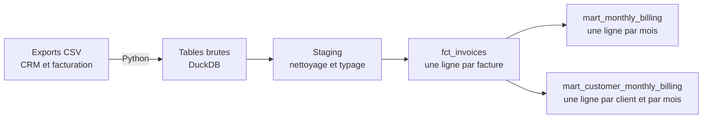

# SaaS Revenue Analytics

[](https://github.com/MelvinBrdt/saas-revenue-analytics/actions/workflows/dbt-ci.yml)

**Combien facture-t-on, à quels clients et quel mois ?**

Ce projet répond à cette question pour une entreprise SaaS B2B fictive. Il part des exports bruts d'un CRM et d'un outil de facturation, puis les transforme en tables fiables, testées et documentées, prêtes pour un tableau de bord ou un reporting finance.

**Outils :** SQL, dbt Core, DuckDB, Python, Git et GitHub Actions.

Les données sont entièrement synthétiques : ce dépôt ne contient aucune donnée réelle ni personnelle.

## Ce que ce projet démontre

| Compétence | Dans ce projet |
|---|---|
| Modélisation analytique | Trois couches (staging, table de faits, marts) avec un grain explicite pour chaque modèle |
| Rigueur métier | Une définition claire du montant facturé, distinct du MRR, de l'encaissé et du revenu comptabilisé |
| Qualité des données | 40 tests de données et 2 tests unitaires, dont une réconciliation entre les marts |
| Automatisation | Un pipeline de CI qui reconstruit et teste tout le projet à chaque Pull Request |
| Reproductibilité | Des dépendances verrouillées et des données de démonstration identiques à chaque exécution |
| Méthode de travail | Des branches dédiées, des Pull Requests décrites et une branche `main` protégée |

## Le besoin métier

Une équipe finance veut suivre sa facturation par mois et par client. Le risque habituel dans ce type de reporting est que tout le monde parle de « revenu » sans parler de la même chose. Le projet fixe donc ce qu'il mesure et ce qu'il ne mesure pas :

| Indicateur | Définition | Mesuré ici |
|---|---|---|
| **Montant facturé** | Total des factures payées (`paid`) ou en attente (`open`), hors factures annulées (`void`) | Oui |
| Encaissé | Argent réellement reçu | Non |
| MRR | Revenu récurrent mensuel | Non |
| Revenu comptabilisé | Revenu rattaché à sa période comptable | Non |

## Les résultats

Facturation par mois, de janvier à juin 2026 :

| Mois | Montant facturé | Factures émises | Factures annulées |
|---|---:|---:|---:|
| Janvier | 198,00 € | 2 | 0 |
| Février | 396,00 € | 4 | 0 |
| Mars | 744,00 € | 6 | 1 |
| Avril | 695,00 € | 5 | 1 |
| Mai | 845,00 € | 7 | 0 |
| Juin | 844,00 € | 6 | 0 |
| **Total** | **3 722,00 €** | **30** | **2** |

La vue par client montre ce que le total ne montre pas. Le client C005 représente par exemple 35 % du montant facturé sur la période. Voici l'historique du client C004, dont l'abonnement a pris fin le 30 avril :

| Mois | Montant facturé | Factures émises | Factures annulées | Lecture |
|---|---:|---:|---:|---|
| Février | 149,00 € | 1 | 0 | Facturation normale |
| Mars | 149,00 € | 1 | 0 | Facturation normale |
| Avril | 0,00 € | 0 | 1 | Facture annulée, le client reste visible |
| Mai | 30,00 € | 1 | 0 | Facture émise après la fin de l'abonnement, bien comptée |

## L'architecture



| Couche | Modèles | Rôle |
|---|---|---|
| Staging | `stg_crm__customers`, `stg_billing__subscriptions`, `stg_billing__invoices` | Nettoyer et typer les données brutes, sans règle métier |
| Table de faits | `fct_invoices` | Rattacher chaque facture à son client et calculer le montant facturé, à un seul endroit |
| Marts | `mart_monthly_billing`, `mart_customer_monthly_billing` | Fournir des agrégats prêts à l'emploi pour la finance |

## Les décisions de modélisation

- **Les factures annulées restent dans `fct_invoices`.** Elles valent 0 € dans le montant facturé, mais restent comptées pour garder la trace des annulations.
- **Une facture sans abonnement connu n'est pas écartée.** Un `left join` la conserve pour que les totaux restent justes, et un test la signale au lieu de la faire disparaître en silence.
- **Une facture émise après la fin d'un abonnement reste comptée.** Filtrer sur les dates de résiliation ferait diverger le mart de la facturation réelle.
- **Le mart par client ne contient que les mois avec au moins une facture.** Ajouter les mois sans facture demande de définir la population suivie, ce qui reste à faire.
- **DuckDB plutôt qu'un entrepôt cloud.** Le projet se lance en quelques minutes, sans compte ni serveur, et les principes de modélisation restent les mêmes.

## La qualité des données

| Type de contrôle | Ce qu'il protège | Exemple |
|---|---|---|
| Tests de colonnes | Les clés, les valeurs autorisées et les liens entre tables | Un statut de facture inconnu fait échouer le build |
| Tests singuliers | Les règles propres au projet | Un client ne peut apparaître qu'une fois par mois |
| Réconciliation | La cohérence entre les modèles | Le mart par client et le mart mensuel donnent les mêmes totaux |
| Tests unitaires | La logique SQL, avec des résultats attendus écrits à la main | Une facture annulée vaut 0 € et plusieurs factures d'un même mois donnent une seule ligne |

Les données de démonstration contiennent volontairement des cas difficiles : plusieurs factures d'un même client sur un même mois, deux abonnements pour un même client, un mois où la seule facture est annulée, une facture émise le dernier jour du mois et un statut brut mal formaté. Les tests ont aussi été éprouvés en cassant volontairement les modèles, pour vérifier qu'ils échouent bien quand il le faut.

Chaque Pull Request déclenche la [CI](.github/workflows/dbt-ci.yml), qui régénère les données, reconstruit le projet et lance tous les tests. Une règle GitHub protège `main` : chaque changement passe par une Pull Request, et cette CI doit réussir avant la fusion.

## Lancer le projet

Il faut Python 3.12, la version utilisée en CI. Depuis la racine du dépôt, sous Linux, macOS ou WSL :

```bash
python3 -m venv .venv
source .venv/bin/activate
python -m pip install -r requirements.txt
python scripts/generate_data.py
python scripts/load_raw.py
dbt build --profiles-dir .
```

Sous Windows PowerShell, activez l'environnement avec `.venv\Scripts\Activate.ps1`.

Pour parcourir la documentation des modèles et le graphe de dépendances dans le navigateur :

```bash
dbt docs generate --profiles-dir .
dbt docs serve --profiles-dir .
```

## L'organisation du dépôt

```text
.github/workflows/   CI GitHub Actions
data/raw/            Exports CSV de démonstration
models/staging/      Nettoyage et typage des sources
models/marts/        Table de faits et marts finance
scripts/             Génération et chargement des données
tests/               Tests singuliers
```

## Les limites

Ce projet est une démonstration, pas un système en production :

- Les données sont peu nombreuses et générées par script.
- Les tables brutes sont remplacées à chaque chargement, sans traitement incrémental.
- Le périmètre est simplifié : tout est en euros, sans TVA, avoirs, remises ni factures multi-lignes.
- Le projet ne couvre pas les grands volumes ni l'historisation des changements.

## Les prochaines étapes

- Ajouter un lint SQL à la CI.
- Ajouter les mois sans facture au mart par client, avec une population définie.
- Construire un modèle du MRR et du churn à partir des abonnements.
